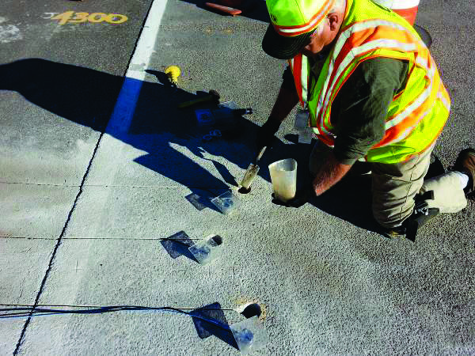

# Pavement Knowledge MCP

Pavement Knowledge MCP connects superintelligence (SI) assistants to **584 Federal Highway Administration (FHWA) pavement research reports**. Researchers can ask a question in their own words, compare what studies found, and follow a citation to the page where a method, measurement or limitation is documented.

Prepared by the Pavement Knowledge MCP team.

[Download the offline package (v0.4.1)](https://github.com/gsa-mcp-hackathon/pavement-knowledge-mcp/releases/tag/v0.4.1) · [Read the evaluation](evaluation/README.md) · [Explore the server code](server/mcp_server/)

## How it works

The SI assistant uses the **Model Context Protocol (MCP)** to request evidence from the local server. The server searches a prepared collection and returns passages with report IDs and PDF page references. The assistant uses those passages to write an answer. The researcher can then inspect the original page and judge whether the finding applies.


**Example from our evaluation**

What can past research tell us about moving a very heavy load? The proposed cargo was a **3-million-pound electrical transformer**, a piece of equipment that changes voltage on the power grid. Engineers wanted to know how the pavement might respond if the vehicle carrying it traveled close to the edge of the road.

The SI assistant used the MCP to find an FHWA laboratory experiment. Researchers pressed a single plate against the pavement **36, 24 and 12 inches from the shoulder edge** and measured how much the pavement moved. An engineer can check those distances in the paragraph above Table 13 on PDF page 65. The table gives the load levels and the number of cycles at each level. To assess the actual route, the engineer would also need to know how the vehicle distributes the weight across its many wheels and how the road is built. [Check the loading positions and Table 13 on PDF page 65](evaluation/superheavy_experiments_case/source_page_065.png) · [Read the paired answers and source checks](evaluation/superheavy_experiments_case/comparison_review.md)

## Contents

[How it works](#how-it-works) · [Research challenges](#research-challenges) · [Who benefits](#who-benefits) · [MnROAD example](#a-question-you-can-check) · [MCP tools](#how-the-assistant-uses-the-server) · [Evaluation](#what-we-tested) · [Limitations](#limitations) · [Lessons and next steps](#lessons-and-next-steps) · [Get started](#get-started) · [Sources and use](#sources-and-use)

<a id="challenge"></a>
<a id="solution"></a>

## Research challenges

A research question often starts with a practical decision. An engineer designing a field experiment may know what needs to be measured and still have to find which study used a comparable setup, how the measurements were taken, and what limited their use. A report title or a general explanation answers only part of that question.

| What gets in the way | How Pavement Knowledge MCP helps |
|---|---|
| **Finding the right study when terminology varies.** An engineer may describe a measurement in different words from the report or may know only a device name or report number. | The assistant can search the publication catalog. For passage retrieval, the server combines semantic search (E5 embeddings in Chroma) with keyword search (BM25) so both related concepts and exact terms can surface. |
| **Finding the detail that determines whether a result applies.** A summary may describe the finding while the sensor placement, load position or test condition appears much later. | The team indexed **68,655 passages from 49,898 source pages**. The assistant can search within a particular report, cite the relevant pages and ask a follow-up about a missing condition. |
| **Separating documented findings from interpretation.** Two studies may address a similar question under different test conditions. | Passages retain their report IDs and PDF page ranges. An assistant can compare the conditions and identify where it is drawing an inference. A reader can inspect each original source before reusing the comparison. |

The team used OCR on selected scans, recovered section headings and retained page references during preparation. At search time, the server merges the semantic and keyword rankings and removes duplicate passages.

<a id="benefit"></a>

## Who benefits

**Researchers, engineers and State DOT practitioners** can use a prior study to inform a new one. For example, an engineer planning a sensor installation can ask how an earlier team positioned its sensors, look up the figure, and decide which parts of the setup to carry over. Page references also give colleagues a common starting point when they disagree about an interpretation. [See the MnROAD sensor case](evaluation/tsdd_instrumentation_case/comparison_review.md)

**FHWA research and technology transfer teams** could make earlier studies easier for State DOTs to find and use. When a DOT asks what FHWA has tested, a specialist can locate the study, check the conditions and share the answer with the original table or figure. A program team scoping a follow-up study can use cited comparisons to distinguish questions earlier experiments addressed from questions that still need field validation. [See the heavy-load comparison and its limits](evaluation/superheavy_experiments_case/comparison_review.md)

## A question you can check

> At MnROAD, which sensors did researchers embed to test traffic-speed deflection devices, and where were they placed relative to the wheel path?

Researchers installed **four geophones and one accelerometer in each of four test cells**. Geophones 1 and 3 lay on the centerline of the right wheel path. Geophones 2 and 4 sat 6 inches to either side. The accelerometer shared the housing of geophone 3. [FHWA-HRT-15-074, PDF pp. 64–65](https://www.fhwa.dot.gov/publications/research/infrastructure/pavements/15074/15074.pdf#page=64)



*Partial grouting of the sensors at MnROAD. Photo from FHWA's Pavement Structural Evaluation at the Network Level: Final Report, FHWA-HRT-15-074, Figure 28, PDF page 67 (printed page 47).* [View the photo in the report](evaluation/tsdd_instrumentation_case/source_page_067.png)

**Why check the original figure?** Neither answer, with or without MCP, mentioned the spacing along the road. Figure 24 shows that each geophone was placed one foot farther along the direction of travel. An engineer planning a similar installation can use the cited drawing to recover that detail. [Inspect the original sensor layout, Figure 24, PDF page 65](evaluation/tsdd_instrumentation_case/source_page_065.png) · [Read the case review](evaluation/tsdd_instrumentation_case/comparison_review.md)

## How the assistant uses the server

| MCP tool | When the SI assistant uses it | What comes back |
|---|---|---|
| `search_publications` | Find reports by topic, title or report number. | Matching publications and document IDs. |
| `get_publication` | Check the identity of a known report. | Report metadata and the available source link. |
| `retrieve_evidence` | Search across the collection, focus on one report or request a report overview. | Passages with report IDs and PDF page ranges. |

The tools can be used independently. For the MnROAD question, an assistant that knows the report ID can call `retrieve_evidence` directly with `FHWA_HRT_15_074`. The packaged model and index run locally. The server needs no answer-generation API key. The SI assistant may use an online service to write its answer. [Server guide and example question](server/README.md)

## What we tested

The team compared answers to two research questions with and without Pavement Knowledge MCP. In the heavy-load case, access to the report helped the assistant supply the experimental details and their source. In the sensor case, the assistant retrieved more detail but also repeated an apparent error in the report. A team pavement subject-matter expert (SME) approved the AI-assisted assessments on November 12, 2026. The scores describe these two examples. [Evaluation method and comparison limits](evaluation/README.md#how-the-answers-were-reviewed)

| Evaluation | Finding | Supporting records |
|---|---|---|
| Heavy-load experiments | Without the MCP, the assistant gave general guidance (**5/8**). With it, the answer identified loading positions **36, 24 and 12 inches from the shoulder edge** and cited the report page and loading protocol (**8/8**). | [Case review and scores](evaluation/superheavy_experiments_case/comparison_review.md) · [Original answer without MCP](evaluation/superheavy_experiments_case/answer_without_mcp.txt) · [Original answer with MCP](evaluation/superheavy_experiments_case/answer_with_mcp.txt) |
| MnROAD sensor study | The assistant using MCP identified the fourth test cell and explained measurement alignment. It also repeated an apparent error in the source’s speed formula. The answers scored **6/8** without the MCP and **7/8** with it. | [Case review and correction](evaluation/tsdd_instrumentation_case/comparison_review.md) · [Original answer without MCP](evaluation/tsdd_instrumentation_case/answer_without_mcp.txt) · [Original answer with MCP](evaluation/tsdd_instrumentation_case/answer_with_mcp.txt) |
| Server operation, October 21 | All **16/16 requests using actual reports** produced the expected results, including expected error responses. | [Technical evaluation](server/evaluation/REPORT.md) · [Test inputs](server/evaluation/cases.json) · [Recorded results](server/evaluation/results.json) |
| Offline installation, November 17 | On Windows x64 with Python 3.11.14, **25/25 software checks** and **7/7 local tool checks** passed after a fresh offline installation. | [Final package verification](evaluation/software_verification_2026-11-17.md) · [Recorded tool responses](evaluation/portable_results_2026-11-17.json) |
| Practical use with Claude | A second pavement SME reported installing the package, using it with Claude and approving the answers they reviewed. This was qualitative feedback. | [Claude trial](evaluation/claude_trial_review.md) · [Broader team and expert review](evaluation/internal_sme_use_review.md) |

The separate **Evaluation Report** accompanies the hackathon submission. The [repository evaluation guide](evaluation/README.md) indexes its supporting records.

## Limitations

- **Coverage.** The release searches a fixed snapshot of selected FHWA pavement reports. New publications require a collection update. An unsuccessful search does not establish that a topic has never been studied.
- **Relevance and completeness.** A passage can match the topic but omit a study condition, exception or figure. Check the surrounding pages before applying a result. For scans, tables and figures, consult the original PDF.
- **Source accuracy.** In the MnROAD case, the answer repeated an apparent inversion in the report’s speed formula. Reviewers checked the original page and documented that speed equals axle spacing divided by elapsed time. [See the answer and correction](evaluation/tsdd_instrumentation_case/comparison_review.md#correction-before-reuse).

## Lessons and next steps

During testing, assistants sometimes skipped the pavement tools or selected passages that only partly answered the question. We refined the tool descriptions and added an [optional pavement research skill](server/skills/pavement-research/SKILL.md) that guides the assistant in selecting tools, checking source support and identifying gaps.

Future work could extend the approach to other transportation research collections, automate updates as new reports appear, and offer shared hosted access. Release v0.4.1 runs locally with the packaged snapshot.

## Get started

1. [Open release v0.4.1](https://github.com/gsa-mcp-hackathon/pavement-knowledge-mcp/releases/tag/v0.4.1). Under **Assets**, download **`Pavement-Knowledge-MCP-0.4.1-offline.zip`**. This ZIP contains the server, report collection, index, search model and offline Python packages. GitHub’s *Source code* archives contain only the repository files.
2. Extract the ZIP to a short path such as `C:\MCP`. Use **Windows x64, Python 3.11**, and an MCP-compatible client that can launch a local process over STDIO. This is the platform we tested. Allow about **3.4 GB** for the extracted package, plus space for Python and installed dependencies. Keep the supplied folders together and `runtime/` writable.
3. Open PowerShell in the extracted `Pavement-Knowledge-MCP` folder. Verify the files before installation or first launch, then install the supplied packages.

   ```powershell
   py -3.11 -I -B verify_bundle.py
   .\server\setup.ps1 -Wheelhouse .\wheelhouse
   ```

4. Run the local tool checks. Choose a new output filename when repeating the checks.

   ```powershell
   .\server\.venv\Scripts\python.exe -I -B server\evaluation\run_local.py --runtime .\runtime --output local-results.json
   ```

5. Print the connection settings and enter them in your client’s MCP configuration. The first request may take tens of seconds while the model loads.

   ```powershell
   .\server\.venv\Scripts\python.exe -I -B server\configure_client.py
   ```

The [server guide](server/README.md) includes a question to try, client configuration guidance and troubleshooting. The [restricted-environment guide](server/SANDBOX_SETUP.md) covers alternatives when scripts or network access are restricted.

## Sources and use

Pavement Knowledge MCP is an unofficial research prototype. The offline ZIP includes `runtime/SOURCES.csv`, which lists the reports and original source links. Check the cited report for figures, tables and surrounding context before relying on a technical conclusion. See the [source and software notices](NOTICE.md) and the [use notice](USE_NOTICE.md).
