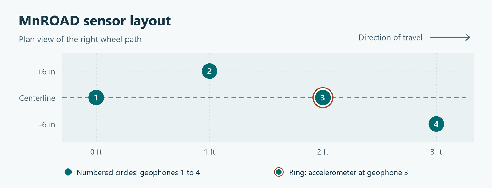

# Pavement Knowledge MCP

Prepared by the Pavement Knowledge MCP team.

Pavement Knowledge MCP lets an AI assistant search **584 Federal Highway Administration (FHWA) pavement reports** and cite the pages behind its answer. An engineer can follow those citations to the test setup, figure or table before using a finding to plan a study.

[Try the offline package (v0.4.1)](https://github.com/gsa-mcp-hackathon/pavement-knowledge-mcp/releases/tag/v0.4.1) · [Review the evaluation](evaluation/README.md) · [Explore the server code](server/mcp_server/)

## Contents

- [Challenge](#challenge)
- [Benefit](#benefit)
- [Solution](#solution)
- [A question you can check](#a-question-you-can-check)
- [How the assistant uses the server](#how-the-assistant-uses-the-server)
- [What we tested](#what-we-tested)
- [Limitations](#limitations)
- [Lessons and next steps](#lessons-and-next-steps)
- [Get started](#get-started)
- [Sources and use](#sources-and-use)

## Challenge

Researchers need to know what previous studies found, how those findings were established, and whether they apply to the question at hand. That evidence is often spread across long technical reports, and a conclusion may depend on a test condition, assumption, or limitation described elsewhere in the document. To support this work, a general-purpose AI assistant needs access to the relevant evidence and a way for researchers to verify the sources behind its answer.

## Benefit

Pavement Knowledge MCP connects the reasoning and synthesis capabilities of a general-purpose AI assistant with evidence from **584 FHWA pavement reports**. The assistant can use that evidence to compare methods, interpret differences across studies, and identify questions the available research leaves open. Report and page references let researchers check the underlying evidence and decide how it applies to their work.

## Solution

Our team prepared a fixed collection covering **49,898 source pages and 68,655 searchable passages**. Three design decisions help the assistant find evidence it can use.

| Retrieval challenge | How we addressed it |
|---|---|
| Scanned pages, repeated headers and complex layouts interfere with text extraction. | We used OCR on selected scans, recovered section headings and kept report IDs and page references with the passages. |
| Engineers may describe the same idea in different words or search for an exact technical term. | For questions, we combine semantic search (E5 embeddings in Chroma) with keyword search (BM25), merge the rankings and remove duplicate passages. |
| A broad search can return the right topic from the wrong study. | The assistant can narrow retrieval to one report, or request an overview drawn from several sections. |

For example, when an engineer asks what a laboratory study can tell them about moving a 3-million-pound transformer, the MCP retrieves the loads, test positions and measurements. The assistant can then explain what those tests established and where the proposed multiwheel move goes beyond the experiment. The engineer can check that interpretation against the cited pages. [Read the heavy-load comparison](evaluation/superheavy_experiments_case/comparison_review.md).

## A question you can check

> At MnROAD, which sensors did researchers embed to test traffic-speed deflection devices, and where were they placed relative to the wheel path?

Researchers installed **four geophones and one accelerometer** in each of four test cells. Geophones 1 and 3 lay on the centerline of the right wheel path. Geophones 2 and 4 sat 6 inches to either side, increasing the chance that a vehicle sensor would pass over an embedded sensor. The accelerometer shared the housing of geophone 3. The report’s diagram also shows 1 foot between successive positions in the direction of travel. [FHWA-HRT-15-074, PDF pp. 64–65, Figure 24](https://www.fhwa.dot.gov/publications/research/infrastructure/pavements/15074/15074.pdf#page=64)



*Team illustration based on Figure 24. The [original figure](evaluation/tsdd_instrumentation_case/source_page_065.png) is on PDF page 65 (printed page 45). The [case review](evaluation/tsdd_instrumentation_case/comparison_review.md) links the two original answers and records which details reviewers verified.*

## How the assistant uses the server

| When the assistant needs to… | MCP tool | What the result provides |
|---|---|---|
| Find publications by topic, title or report number | `search_publications` | Matching reports and document IDs |
| Check which publication it has found | `get_publication` | Report metadata and the available source link |
| Answer a question from the collection or a particular report | `retrieve_evidence` | Passages with report IDs and PDF page ranges |

For the MnROAD question, an assistant that already knows the report ID can call `retrieve_evidence` directly with `FHWA_HRT_15_074`. Retrieval runs locally using the packaged search model and index. The AI client uses the returned evidence to compose its answer. The server needs no answer-generation API key. The client may use an online service.

## What we tested

The Pavement Knowledge MCP team documented the tests below. A team pavement subject-matter expert reviewed and approved the AI-assisted assessments of the two paired answers on November 12, 2026. The scores apply to those two questions. [Evaluation guide and scoring criteria](evaluation/README.md#how-the-answers-were-reviewed).

| Evaluation | Finding | Supporting records |
|---|---|---|
| Heavy-load experiments | Without the MCP, the assistant gave general guidance (**5/8**). With it, the answer identified loading positions **36, 24 and 12 inches from the shoulder edge** and cited Table 13 (**8/8**). | [Case review and scores](evaluation/superheavy_experiments_case/comparison_review.md) · [Original answer without MCP](evaluation/superheavy_experiments_case/answer_without_mcp.txt) · [Original answer with MCP](evaluation/superheavy_experiments_case/answer_with_mcp.txt) |
| MnROAD sensor study | The MCP answer identified the fourth test cell and explained measurement alignment. It also repeated an apparent error in the source’s speed formula. The answers scored **6/8** without the MCP and **7/8** with it. | [Case review and correction](evaluation/tsdd_instrumentation_case/comparison_review.md) · [Original answer without MCP](evaluation/tsdd_instrumentation_case/answer_without_mcp.txt) · [Original answer with MCP](evaluation/tsdd_instrumentation_case/answer_with_mcp.txt) |
| Server operation, October 21 | All **16/16 requests using actual reports** produced the expected results, including expected error responses. | [Technical evaluation](server/evaluation/REPORT.md) · [Test inputs](server/evaluation/cases.json) · [Recorded results](server/evaluation/results.json) |
| Offline installation, November 17 | On Windows x64 with Python 3.11.14, **25/25 software checks** and **7/7 local tool checks** passed after a fresh offline installation. | [Final package verification](evaluation/software_verification_2026-11-17.md) · [Recorded tool responses](evaluation/portable_results_2026-11-17.json) |
| Practical use with an AI client | A second pavement subject-matter expert reported installing the package, using it with Claude and approving the answers they reviewed. This was qualitative feedback. | [Claude trial](evaluation/claude_trial_review.md) · [Broader team and expert review](evaluation/internal_sme_use_review.md) |

The separate **Evaluation Report** accompanies the hackathon submission. The [repository evaluation guide](evaluation/README.md) indexes its supporting records.

## Limitations

- **Coverage.** The release searches a fixed snapshot of selected FHWA pavement reports. New publications require a collection update. An unsuccessful search does not establish that a topic has never been studied.
- **Relevance and completeness.** A passage can match the topic but omit a study condition, exception or figure. Check the surrounding pages before applying a result. For scans, tables and figures, consult the original PDF.
- **Source accuracy.** In the MnROAD case, the answer repeated an apparent inversion in the report’s speed formula. Reviewers checked the original page and documented that speed equals axle spacing divided by elapsed time. [See the answer and correction](evaluation/tsdd_instrumentation_case/comparison_review.md#correction-before-reuse).

## Lessons and next steps

During testing, assistants sometimes skipped the pavement tools or selected passages that only partly answered the question. We refined the tool descriptions and added an [optional pavement research skill](server/skills/pavement-research/SKILL.md) that guides the assistant in selecting tools, checking source support and identifying gaps.

Future work could extend the approach to other transportation research collections, automate updates as new reports appear, and offer shared hosted access. Release v0.4.1 runs locally with the packaged snapshot.

## Get started

1. [Open release v0.4.1](https://github.com/gsa-mcp-hackathon/pavement-knowledge-mcp/releases/tag/v0.4.1). Under **Assets**, download **`Pavement-Knowledge-MCP-0.4.1-offline.zip`**. This ZIP contains the server, report collection, index, search model and offline Python packages. GitHub’s *Source code* archives contain only the repository files.
2. Extract the ZIP to a short path such as `C:\MCP`. Use **Windows x64, Python 3.11**, and an MCP-compatible AI client that can launch a local process over STDIO. This is the platform we tested. Allow about **3.4 GB** for the extracted package, plus space for Python and installed dependencies. Keep the supplied folders together and `runtime/` writable.
3. Open PowerShell in the extracted `Pavement-Knowledge-MCP` folder. Verify the files before installation or first launch, then install the supplied packages.

   ```powershell
   py -3.11 -I -B verify_bundle.py
   .\server\setup.ps1 -Wheelhouse .\wheelhouse
   ```

4. Run the local tool checks. Choose a new output filename when repeating the checks.

   ```powershell
   .\server\.venv\Scripts\python.exe -I -B server\evaluation\run_local.py --runtime .\runtime --output local-results.json
   ```

5. Print the connection settings and enter them in your client’s MCP configuration. The first request may take tens of seconds while the model loads.

   ```powershell
   .\server\.venv\Scripts\python.exe -I -B server\configure_client.py
   ```

The [server guide](server/README.md) includes a question to try, client configuration guidance and troubleshooting. The [restricted-environment guide](server/SANDBOX_SETUP.md) covers alternatives when scripts or network access are restricted.

## Sources and use

Pavement Knowledge MCP is an unofficial research prototype. The offline ZIP includes `runtime/SOURCES.csv`, which lists the reports and original source links. Check the cited report for figures, tables and surrounding context before relying on a technical conclusion. See the [source and software notices](NOTICE.md) and the [use notice](USE_NOTICE.md).
